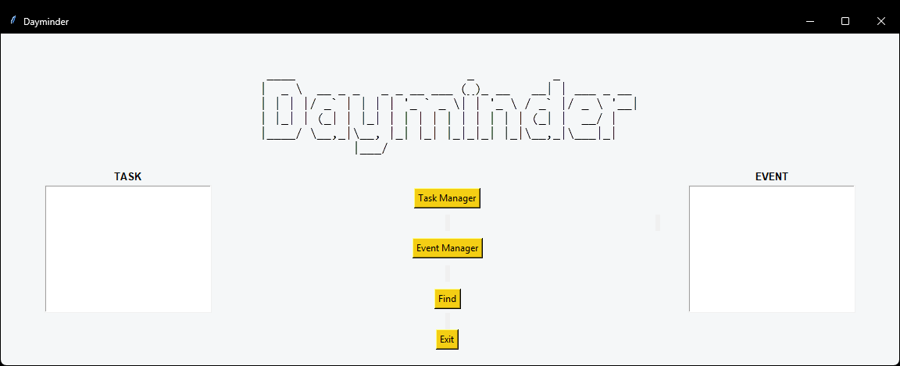
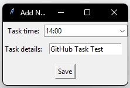
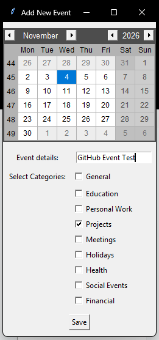
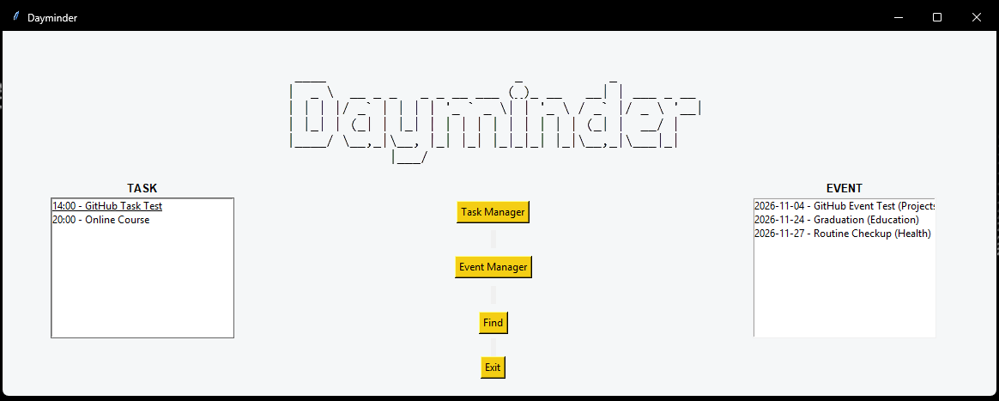

# Dayminder

Documentation code of uni project using Python Tkinter for GUI

Dayminder is a simple desktop application built with Python and Tkinter to help users keep track of their events and tasks. It provides a graphical user interface (GUI) where users can add entries, set their names, and specify their dates and times.

This project was developed as a final assignment for the Advanced Programming course (_Pemrograman Lanjut_).

## Features

- **Event Management** — Add events with a name, date, and time.
- **Task Management** — Add tasks with a name, date, and time.
- **Separate Categories** — Keep events and tasks organized in separate sections.
- **Graphical User Interface** — Manage entries through a desktop GUI built with Tkinter.

## Tech Stack

- **Language:** Python
- **GUI Framework:** Tkinter, Tkcalendar

### Main Interface



### Task Management



### Event Management



### Sample Entries Result



## Project Context

Dayminder was developed as a final assignment for the Advanced Programming practical course. The project was completed collaboratively, with my contribution being the implementation and coding of the application.

## Getting Started

### Prerequisites

- Python 3.x
- Tkinter (usually included with standard Python installations)
- Tkcalendar

### Run the Application

1. Clone this repository:

   ```bash
   git clone https://github.com/nasywarc/portofolio-dayminder-project.git
   ```

2. Navigate to the project directory:

   ```bash
   cd portofolio-dayminder-project
   ```

3. Run the application:

   ```bash
   py dayminder.py
   ```

   Replace `main.py` with the actual entry-point filename if it differs.

---

_Developed as part of the Advanced Programming course._
